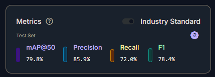
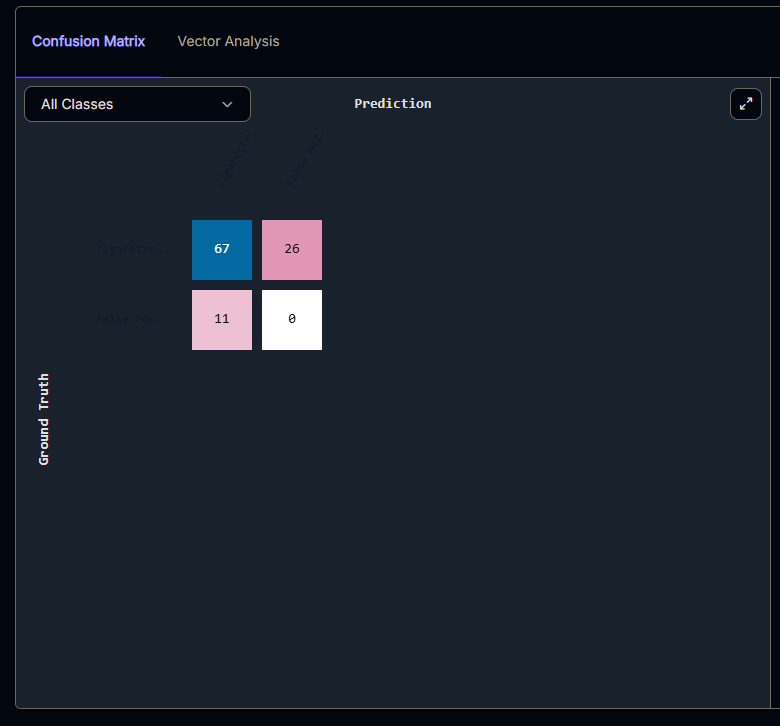
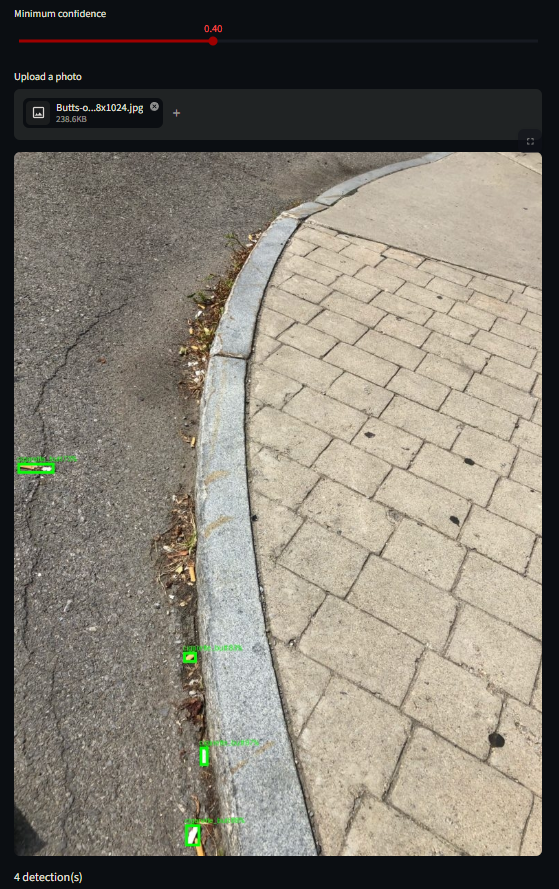
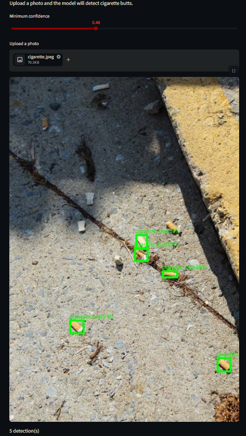

# StreetScan

**A computer vision model that finds and counts cigarette butts in street photos, so a municipality can measure where butts pile up and whether a measure against them works.**

> AI for Good minor · Hackathon 7: *Eyes on Earth*

---

## At a glance

| | |
|---|---|
| **Project title** | StreetScan |
| **My pair partner** | Haki Abdulovski |
| **Tool we had to use** | [Roboflow](https://roboflow.com): we labelled our own images and trained a custom object detection model (RF-DETR Small) on it |
| **SDG we had to address** | SDG 15: Life on Land |
| **Our data** | 599 labelled photos and video frames of pavement, gutters and grass edges, taken by us in Leidschendam, The Hague and Rijswijk, October 2026 |
| **Intended user** | The **Haagse Straat Organisatie (HSO)** of the Municipality of The Hague, the team that keeps the city's public space clean (intended user, not a partner) |
| **Live app** | https://ai4g-portfolio-evaldaspocius-c74d5aqejkvpvhwqvc49am.streamlit.app/ |

---

## 1. What problem does it solve, and for whom?

### The problem

Cigarette butts are the most common piece of street litter in the Netherlands, and nobody knows exactly how many there are.

- **Huge numbers, poorly measured.** People in the Netherlands smoke more than 10 billion cigarettes a year. Rough estimates of how many butts end up on the street, in grass or on the beach range from **240 million to 7.1 billion** a year, a 30-fold range ([report for the Ministry of Infrastructure and Water Management, 2024](https://eerstekamer.nl/9370000/1/j4nvgs5kjg27kof_j9vvkfvj6b325az/vmj8li1ujhxr), based on [CE Delft, 2022](https://cedelft.eu/publications/reducing-the-amount-of-cigarette-filters-in-litter/)).
- **The biggest single item on the street.** In Utrecht, butts make up about **20 - 30% of all street litter** ([Gemeente Utrecht, Dec 2025](https://www.utrecht.nl/nieuws/nieuwsbericht-gemeente-utrecht/nieuwe-utrechtse-campagne-tegen-peukenafval)). In Rijkswaterstaat's national litter monitor, butts were the most common item within the non-packaging and small litter categories (31%) ([Trimbos Institute, 2022](https://www.trimbos.nl/wp-content/uploads/2025/10/AF1982-Milieuschade-door-peukenafval.pdf)).
- **A national target that is being missed.** In 2022 the House of Representatives asked how the number of butts in litter could be cut by **70% in 2026 compared to 2022**. Current policy is expected to achieve **at most about 15%** ([Kamerbrief, April 2023](https://zoek.officielebekendmakingen.nl/kst-30872-291.pdf); [CE Delft](https://cedelft.eu/publications/reducing-the-amount-of-cigarette-filters-in-litter/)).

**What goes wrong for a municipality today:** to know whether a measure works (an extra bin, a sticker campaign, a smoke-free zone), someone has to **count butts by hand** before and after, spot by spot. Utrecht does exactly this in its 2025 - 2026 pilot at bus stops: it counts butts before, during and after the pilot and only expands the approach if there are at least 30% fewer butts ([Gemeente Utrecht](https://www.utrecht.nl/nieuws/nieuwsbericht-gemeente-utrecht/nieuwe-utrechtse-campagne-tegen-peukenafval)). The national litter monitor measures at about 1,400 locations for the whole country ([Trimbos](https://www.trimbos.nl/wp-content/uploads/2025/10/AF1982-Milieuschade-door-peukenafval.pdf)), which says nothing about one specific street or bus stop. Counting small butts between paving stones by hand is slow, so it is done rarely and at few spots.

Since 2023, tobacco producers must pay for the cleaning of public space under Extended Producer Responsibility (UPV), but **monitoring and enforcement are not covered** by that money ([Gemeente.nu](https://gemeente.nu/ruimte-milieu/afval/rekening-zwerfafval-gaat-deels-verplicht-naar-bedrijven)). Municipalities pay for measuring themselves.

### The user and their decision

**User:** the **Haagse Straat Organisatie (HSO)**, the unit of the Municipality of The Hague's Dienst Stadsbeheer (city management department) that keeps the city's public space clean ([Gemeente Den Haag](https://www.denhaag.nl/nl/bestuur-en-organisatie/gemeentelijke-organisatie/de-gemeentelijke-organisatie.htm)). Together with Haagse Milieu Services (HMS), it carries out The Hague's *Aanvalsplan Afval 2023 - 2026* (waste action plan).

That plan has a problem our tool fits directly. In The Hague's own measurements, the score for **fine litter, mainly cigarette filters**, was only **39% in Q1 2025 and 49% in Q4 2025** in the city's focus areas. The 25 focus neighbourhoods scored 64% on eight litter types, against an ambition of 80%. The municipality says fine litter will get **extra attention in 2026** ([Gemeente Den Haag, progress report Aanvalsplan Afval 2025, 24 April 2026](https://www.denhaag.nl/pers/?p=4663)).

This is our *intended* user; we have not worked with the HSO, and they are not using the tool. We took our photos in and around The Hague for that reason.

**Their decisions:**
1. **Where to act:** which streets, bus stops or green edges have the most butts, and therefore need a bin, an ashtray, a campaign or extra cleaning.
2. **Whether a measure works:** do the same spots have fewer butts after the measure than before, as in Utrecht's pilot?

**Who it is not for:** it is not for fining individual smokers, not for citizens checking their own street, and not for official cost claims.

### Why this fits SDG 15

SDG 15 is about protecting and restoring land ecosystems; target 15.1 explicitly includes *inland freshwater ecosystems* ([UN](https://turkiye.un.org/en/sdgs/15)). Cigarette butts damage both:

- **They are plastic.** Filters are made of cellulose acetate, which breaks down into microplastics but hardly biodegrades. One butt releases about 100 microplastic fibres a day ([Trimbos](https://www.trimbos.nl/wp-content/uploads/2025/10/AF1982-Milieuschade-door-peukenafval.pdf)).
- **They leak toxins into soil and water.** Heavy metals, nicotine and other chemicals wash out with rain. In a greenhouse study, 27% fewer white clover seeds germinated in the presence of smoked butts, and grass and clover grew less ([Trimbos](https://www.trimbos.nl/wp-content/uploads/2025/10/AF1982-Milieuschade-door-peukenafval.pdf), citing Green et al., 2019). The effect on land animals is smaller than in water ([Trimbos](https://www.trimbos.nl/wp-content/uploads/2025/10/AF1982-Milieuschade-door-peukenafval.pdf)).
- **From the street they reach the water.** Via wind and drains, butts end up in canals and ditches. In a lab test, the leachate of **one smoked butt per litre of water killed half of the test fish** ([Slaughter et al., 2011, Tobacco Control](https://ucl.scienceopen.com/document_file/1aefb1c2-1d6e-4836-b9cf-7055849c17ef/PubMedCentral/1aefb1c2-1d6e-4836-b9cf-7055849c17ef.pdf)).

A municipality that can see where butts collect can stop them earlier, before they reach verges, soil and water.

### Why this is not a Google search

A search tells you that butts are a problem in general. It cannot tell a municipality how many butts lie at *this* bus stop *this* week, or whether that number went down after a new bin was placed. Counting by hand can, but it is slow and expensive. StreetScan turns a phone photo into a count in seconds, so the same spots can be measured more often.

---

## 2. What did we build?

We trained our own object detection model in Roboflow on 599 photos we took ourselves, and wrapped it in a web app, **StreetScan**. A user uploads a photo of a street, gutter or grass edge. The app sends it to our model, draws a box around every cigarette butt it finds, and shows the total count. The user can set how confident the model must be before a box counts.

**What a user can do with it:**
- Photograph the same spots before and after a measure, and compare the counts.
- Compare spots (bus stop vs. park entrance vs. terrace) to see where butts pile up.
- See *which* objects the model counted, so they can check its work instead of trusting a number blindly.

The app does **not** store photos, locations or results: every photo is analysed and then forgotten.

---

## 3. Link to the live thing

- **Live app:** https://ai4g-portfolio-evaldaspocius-c74d5aqejkvpvhwqvc49am.streamlit.app/
- **Video demo:** https://youtu.be/hZIqZImfuRU
- **Model in Roboflow:** `hackathon-civ4a-1-rfdetr-small-t1` (private project, workspace `hakis-workspace-y3j23`)
- **Live demo:** shown in the presentation.

---

## 4. How it works

```
Our phone photos + videos (Leidschendam, The Hague, Rijswijk)
        │  videos cut into frames in Roboflow
        ▼
Roboflow Auto Label (Gemini 4 Argon) draws first boxes
        │
        ▼
Manual review of every image → 599 approved, 2 rejected
        │
        ▼
Dataset version v1 (640×640) → training RF-DETR Small
        │
        ▼
StreetScan (Streamlit) → photo in → boxes + count out
```

### 4.1 Data collection
- **Our own data only:** phone photos and 7 short phone videos (about 5 seconds each, 30 or 60 frames per second) of pavement, gutters, grass edges and verges, taken in October 2026.
- **Frames:** Roboflow cut the videos into still frames during upload, at a sampling rate we chose. Together with the photos this gave **601 images**.
- **Privacy:** we avoided faces and number plates, and the Roboflow project is **private**.

### 4.2 Labelling
- **Task:** object detection with one class, `cigarette_butt`. We chose boxes instead of whole-image labels because the user needs a **count**.
- **First boxes by a large model:** Roboflow's Auto Label with **Gemini 4 Argon**, using our visual description (a short cylinder of 2 - 3 cm, white, beige or orange-brown, often crushed, on pavement, gravel, grass or in gutters).
- **Every image reviewed by us:** we added missed butts, deleted wrong boxes and tightened loose ones. **599 images approved, 2 rejected.**
- **Gemini is only the labelling assistant.** It is not part of our model or our app.

### 4.3 Dataset version v1

| Setting | Choice | Why |
|---|---|---|
| Split | 419 train / 120 valid / 60 test (random 70/20/10) | Roboflow's default split |
| Auto-orient | On | Phone photos stored sideways are turned upright |
| Resize | Fit (black edges) in 640×640 | Keeps the real shape of butts; stretching would distort them |
| Tiling | None | Would help tiny butts, but doubles training time |
| Augmentation | Horizontal flip, during training only | More variety without extra labelling |

### 4.4 Model and training

| | |
|---|---|
| Architecture | Roboflow **RF-DETR, size Small**, pretrained on general images and fine-tuned on our 419 training images |
| Why this model | Roboflow's recommended model, designed to need less data; Small is faster and cheaper to run |
| Engine | Custom Training (not Neural Architecture Search), so we can name and explain the exact model |
| Training cost | 0.77 Roboflow credits (cap set at 2) |
| Speed | about 22 ms per image through Roboflow's cloud API |

**Why our own model and not just Gemini?** Roboflow estimated the Gemini usage for auto-labelling 601 images at about 3.07 credits, about 0.005 credits per image. Our model costs 0.1875 credits per 1,000 images, about 0.0002 per image: **roughly 25 times cheaper per photo**, and much faster.

### 4.5 The app (`app.py`)
A Streamlit page. The user uploads a JPG or PNG; the app sends it to our model through Roboflow's serverless API (`inference-sdk`), keeps only detections above the **"Minimum confidence"** slider (0.1 - 0.9, default **0.40**), draws a box with the confidence on every butt, and shows the number of detections.

---

## 5. Results

### On the test set (60 images, 93 butts)

<p align="center">
  <br>
</p>

| Metric | Score | Plain meaning |
|---|---|---|
| mAP@50 | **79.8%** | Standard overall detection score |
| Precision | **85.9%** | Of the boxes it draws, about 6 in 7 are real butts |
| Recall | **72.0%** | It finds about 3 in 4 butts that are there |
| F1 | **78.4%** | Balance of precision and recall |

At a confidence threshold of 42% (Roboflow's optimum, close to the app's default of 40%):

<p align="center">
  <br>
</p>

| | Model finds a butt | Model finds nothing |
|---|---|---|
| **Real butt (93)** | 67 correct | 26 missed |
| **No butt** | 11 false alarms | - |

**What this means for the user:** counts are usually **somewhat lower than reality**. That is good enough to compare spots and see a trend before and after a measure, as long as the photos are taken in the same way. It is not good enough for exact numbers.

### Why these scores are probably optimistic
Roboflow split the images randomly. Neighbouring frames from the same video look almost identical, so some test images have a near-twin in the training set. A fair test needs new photos from new places; our quick check on two such photos (below) found far fewer butts.

### Why some "errors" are not errors
Roboflow only counts a hit if the model's box overlaps our box by at least 50%. Butts are tiny, so a box shifted by a few pixels fails that test. In one "missed" image, our box and the model's box sit on **the same butt**, yet it is scored as one miss plus one false alarm. For a counting tool, the count matters more than pixel-perfect boxes.

### Where the model fails
- **Grass, leaves and verges:** StreetScan finds it hard to tell leaves apart from cigarette butts.
- **Dark or uneven surfaces:** dark paving, brick and shadows make butts blend in.
- **Tiny, distant butts:** after resizing to 640×640 they are only a few pixels big.
- **Double boxes:** two overlapping boxes can count one butt twice.

### Extra check on two new photos

As a quick check on unseen images, we ran StreetScan on two photos from the internet (not our own, not known if from the Netherlands, not in our dataset) and counted the butts by hand.

| Photo | Surface | Our count | StreetScan count | Note |
|---|---|---|---|---|
|  | Gutter / kerb edge | 13 | 4 | Photo from the internet |
|  | Gutter / kerb edge | 10 | 5 | Photo from the internet |

**Result:** at confidence 0.40, StreetScan found **9 of 23 butts (39%)**, far below the 72% recall on our test set. Most misses were in gutter debris. This supports two points above: the test-set scores are optimistic, and the model works worst outside the conditions it was trained on. Two photos are far too few for a real score; a test on 20 - 40 of our own new photos from new spots is the next step.


---

## 6. How do I run it?

**Online:** open the [live app](https://ai4g-portfolio-evaldaspocius-c74d5aqejkvpvhwqvc49am.streamlit.app/), upload a photo and wait a few seconds.

**On your own computer** (Python 3.10 or newer, and a Roboflow API key with access to the model):

1. Install the packages:
   ```bash
   python -m venv venv
   venv\Scripts\pip install -r requirements.txt      # Windows
   venv/bin/pip install -r requirements.txt          # macOS / Linux
   ```
2. Add your Roboflow API key in a file `.streamlit/secrets.toml`:
   ```toml
   ROBOFLOW_API_KEY = "your-private-key"
   ```
   Add `.streamlit/secrets.toml` to `.gitignore`: this file must **never** be pushed to GitHub. On Streamlit Cloud, put the same line under *App settings → Secrets*.
3. Start the app:
   ```bash
   venv\Scripts\streamlit run app.py                 # Windows
   venv/bin/streamlit run app.py                     # macOS / Linux
   ```
4. Open **http://localhost:8501**.

Every photo is one call to Roboflow's API and uses a very small amount of credits (0.1875 credits per 1,000 images).

---

## 7. Ethical reflection and data card

### Data card

| | |
|---|---|
| **Source** | Our own phone photos and videos; no images from the internet or other datasets |
| **Collected by** | Haki Abdulovski |
| **Where and when** | Leidschendam, The Hague and Rijswijk, October 2026, in day and night, in autumn |
| **What** | Pavement, gutters, drains, grass edges and verges |
| **Size** | 601 images uploaded (photos + frames from 7 videos), 599 labelled and used |
| **Labels** | One class, `cigarette_butt`, as bounding boxes; drafted by Gemini 4 Argon, every image reviewed by hand |
| **Split** | 419 / 120 / 60, random (frames of one video can be in several splits) |
| **Storage** | Private Roboflow project; COCO export in this repository |
| **Known gaps** | Few photos in grass and on dark surfaces; no rain or snow; only three municipalities; autumn leaves everywhere |

### Risks, and who could be harmed

The biggest risk is that the tool **undercounts exactly where it matters most for SDG 15**. A municipality that trusts the numbers could conclude that parks and verges are clean and send its cleaning effort to the streets, while butts keep leaking into soil and water in the green areas. The same goes for comparisons: if the "after" photo is taken on a darker, wetter day, the model finds fewer butts and a measure looks successful when it isn't. Butts are only roughly counted (recall 72%), and the test scores are probably optimistic because of the random split. A second risk is **misuse for enforcement**: counts per spot could be used to target places where certain groups gather (a shelter, a coffee shop, a youth hangout), or photos could show people who never agreed to be photographed. Finally, municipalities can claim cleaning costs from producers under UPV; our counts are **not reliable enough for financial claims**.

### What we did about it
- **The app shows every box, not just a number,** so the user can see what was counted and spot misses or false alarms.
- **The confidence slider is visible,** and the README states the threshold our results are based on (0.40 - 0.42).
- **We documented the weak spots** (grass, dark surfaces, tiny butts, double boxes) and the optimistic split, instead of only reporting the best score.
- **No personal data:** we avoided faces and number plates, the Roboflow project is private, and the app stores no photos, locations or results.
- **We advise a fixed protocol:** compare the same spots, at the same distance and in similar light, and check a few photos by hand.

### What it must not be used for
- Fining or identifying **individual smokers**, or targeting places because of **who** spends time there.
- **Exact counts** for official reports or **cost claims** under UPV.
- Concluding that **green areas are clean**: the model is weakest there.
- Photos of **people**: point the camera at the ground.

### Next steps
More training photos in grass, on dark surfaces and with white filters; tiling for tiny butts; merging overlapping boxes in the app; a location-and-date log so a municipality can track spots over time; and a split by video, so frames of one clip never end up in both train and test.

---

## 8. Who did what?

| | Haki | Evaldas |
|---|---|---|
| Choosing the problem, user and SDG link | ✔ | ✔ |
| Taking the photos and videos | ✔ | |
| Roboflow: upload, labelling review, dataset version | ✔ | |
| Training and evaluating the model | ✔ | |
| Coding the StreetScan app and deployment | | ✔ |
| README and data card | ✔ | |
| Slides and presentation | | ✔ |
| Demo video | | ✔ |
| Ethical Reflection | | ✔ |

**Use of an AI assistant:** we used Claude (Anthropic) to explain Roboflow settings, research sources and help write the README, as the assignment allows. The choices of problem, user, data, labels, model settings and app are ours, and we can explain each of them.

---

## 9. Files in this repository

| File | What it is |
|---|---|
| `app.py` | the StreetScan Streamlit app |
| `requirements.txt` | the Python packages needed (`streamlit`, `inference-sdk`, `pillow`) |
| `hackathon7_data.zip` | Roboflow export of dataset v1 in COCO format: 599 images at 640×640 with labels, split into train / valid / test |
| `README.md` | this file |
| `images` |images for the README.md |
| `StreetScan-Presentation` |Presentation Slides |

---

## Sources

- Gemeente Utrecht, *Nieuwe Utrechtse campagne tegen peukenafval* (12 Dec 2025): https://www.utrecht.nl/nieuws/nieuwsbericht-gemeente-utrecht/nieuwe-utrechtse-campagne-tegen-peukenafval
- Research report for the Ministry of Infrastructure and Water Management on smoking bans on beaches (2024), via Eerste Kamer: https://eerstekamer.nl/9370000/1/j4nvgs5kjg27kof_j9vvkfvj6b325az/vmj8li1ujhxr
- CE Delft, *Reducing the amount of cigarette filters in litter* (Dec 2022): https://cedelft.eu/publications/reducing-the-amount-of-cigarette-filters-in-litter/
- Kamerbrief, *Beleidsopties ter reductie van sigarettenfilters in zwerfafval* (19 April 2023): https://zoek.officielebekendmakingen.nl/kst-30872-291.pdf
- Kamerbrief on the 70% reduction motion (21 April 2022): https://zoek.officielebekendmakingen.nl/kst-30872-277.pdf
- Trimbos Institute, *Milieuschade door peukenafval* (factsheet, 2022): https://www.trimbos.nl/wp-content/uploads/2025/10/AF1982-Milieuschade-door-peukenafval.pdf
- Slaughter et al., *Toxicity of cigarette butts, and their chemical components, to marine and freshwater fish*, Tobacco Control (2011): https://ucl.scienceopen.com/document_file/1aefb1c2-1d6e-4836-b9cf-7055849c17ef/PubMedCentral/1aefb1c2-1d6e-4836-b9cf-7055849c17ef.pdf
- Gemeente Den Haag, *De gemeentelijke organisatie* (Dienst Stadsbeheer, Haagse Straat Organisatie): https://www.denhaag.nl/nl/bestuur-en-organisatie/gemeentelijke-organisatie/de-gemeentelijke-organisatie.htm
- Gemeente Den Haag, press release on the *Voortgangsrapportage Aanvalsplan Afval 2025* (24 April 2026): https://www.denhaag.nl/pers/?p=4663
- Gemeente.nu, *Rekening zwerfafval gaat deels verplicht naar bedrijven*: https://gemeente.nu/ruimte-milieu/afval/rekening-zwerfafval-gaat-deels-verplicht-naar-bedrijven
- United Nations, *SDG 15: Life on Land*: https://turkiye.un.org/en/sdgs/15
- Roboflow: https://roboflow.com